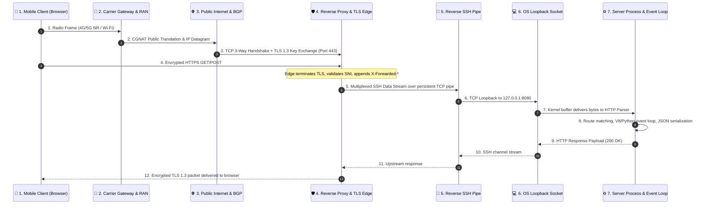
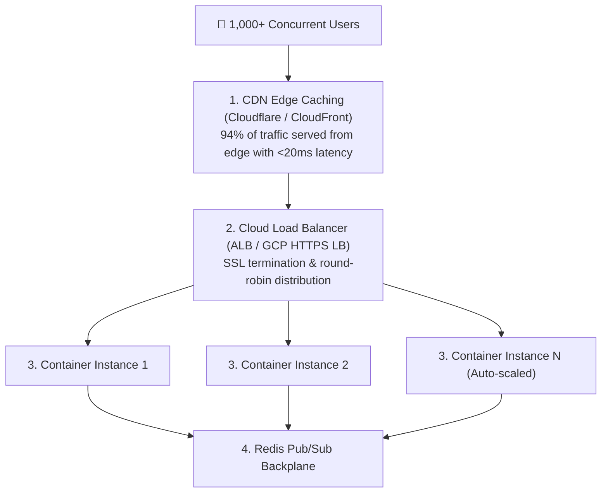

# 🌐 NetLab: Network Architecture & Protocol Visualizer

> An interactive educational web application designed to visually explain **client-server networking, hop-by-hop packet routing, the TCP 3-way handshake, HTTP protocol semantics, edge reverse tunneling, and system scalability** when scaling from 1 to 10,000+ concurrent users.

---

## 🎯 Pedagogical Objectives

When software engineers and students build web applications, network communication often feels like an invisible black box:
- *What happens between the millisecond a user taps a link on their smartphone and the server returning HTML?*
- *How does a packet traverse mobile cellular towers (RAN), carrier NATs, public BGP backbones, and reverse proxies?*
- *Why is a TCP 3-way handshake required before any HTTP or TLS data can be transferred?*
- *Why do residential machines require reverse SSH tunnels to be accessible on the public internet?*
- *What actually breaks when 1,000 users visit a single-node web server simultaneously?*

**NetLab** demystifies every layer of the network stack through live interactive visualizations, packet flow simulations, status code experiments, and a real-time scalability stress-test model.

---

## 🏛️ End-to-End Hop Flow Architecture

Every HTTP request traverses seven critical architectural boundaries:



---

## 🧱 The 4-Layer TCP/IP Model

| Layer | Protocols & Technologies | Data Unit | Role in Web Communication |
|---|---|---|---|
| **4. Application** | HTTP/1.1, HTTP/2, HTTP/3, DNS, TLS 1.3 | Message / Payload | Formats request lines, headers (`User-Agent`, `Host`), cookies, and JSON/HTML bodies. |
| **3. Transport** | TCP, UDP, QUIC | Segment / Datagram | Manages reliable ordered delivery, flow control, port addressing (e.g. 443, 8080), and retransmission. |
| **2. Internet** | IPv4, IPv6, ICMP, BGP | IP Packet | Encapsulates segments into packets with source and destination IP addresses; routed across Autonomous Systems (AS). |
| **1. Link / Physical** | Ethernet (802.3), Wi-Fi (802.11ax), 5G NR | Frame / Bits | Modulates bits into electromagnetic radio waves or laser pulses over optical fiber. |

---

## 🤝 The TCP 3-Way Handshake

Before HTTP data can travel, TCP establishes synchronization through a 3-step handshake:

```text
Client                                Server
  |                                      |
  | -------- SYN (Seq=1000) -----------> |  Step 1: Client sends SYN (State: SYN_SENT)
  |                                      |
  | <-- SYN-ACK (Seq=5000, Ack=1001) --- |  Step 2: Server synchronizes and ACKs (State: SYN_RCVD)
  |                                      |
  | -------- ACK (Seq=1001, Ack=5001) -> |  Step 3: Client acknowledges server SYN (State: ESTABLISHED)
  |                                      |
  | ====== Socket Ready for Data ======  |
```

---

## 📈 Scalability Analysis: What Happens When 1,000+ Users Visit?

When 1,000 users simultaneously visit a single-host reverse tunnel, four catastrophic bottlenecks occur:

1. **Tunnel Edge Socket Cap:** Free tunnel services limit concurrent sockets to ~20–50 connections. The 51st user receives `HTTP 429 Too Many Requests` or `HTTP 502 Bad Gateway`.
2. **TCP Head-of-Line (HoL) Blocking:** All 1,000 user requests are multiplexed over a **single outbound SSH TCP connection**. If a single packet drops over Wi-Fi, the entire TCP window halts until that packet is retransmitted.
3. **Socket Descriptor Exhaustion:** Persistent streaming connections (e.g. Server-Sent Events or WebSockets) hold open 1,000 file descriptors simultaneously, saturating event loops.
4. **Asymmetric Bandwidth:** Residential upload speeds (often 10–20 Mbps) become queued trying to push megabytes of frontend assets out simultaneously.

### The Production Cloud Solution:


---

## 🚀 Running Locally

### 1. Zero-Dependency Standalone Python Server
```bash
cd network-protocol-visualizer
python server.py
# Server starts at http://localhost:8080
```

### 2. Docker Container
```bash
docker build -t netlab .
docker run -p 8080:8080 -e PORT=8080 netlab
```

### 3. Automated Verification Tests
```bash
node test_app.js
```

---

## 📄 License

This project is licensed under the [MIT License](../LICENSE).
