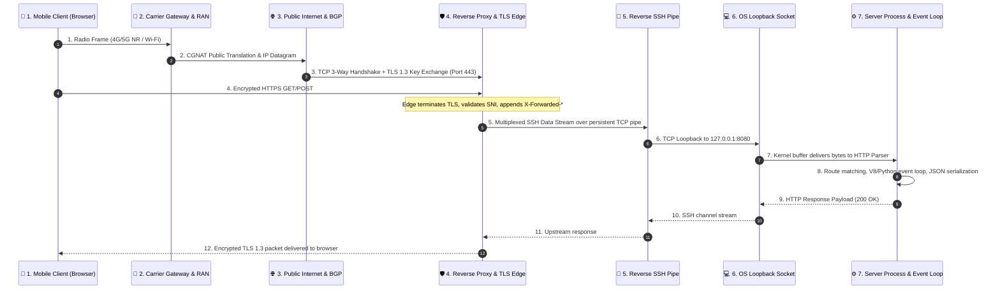
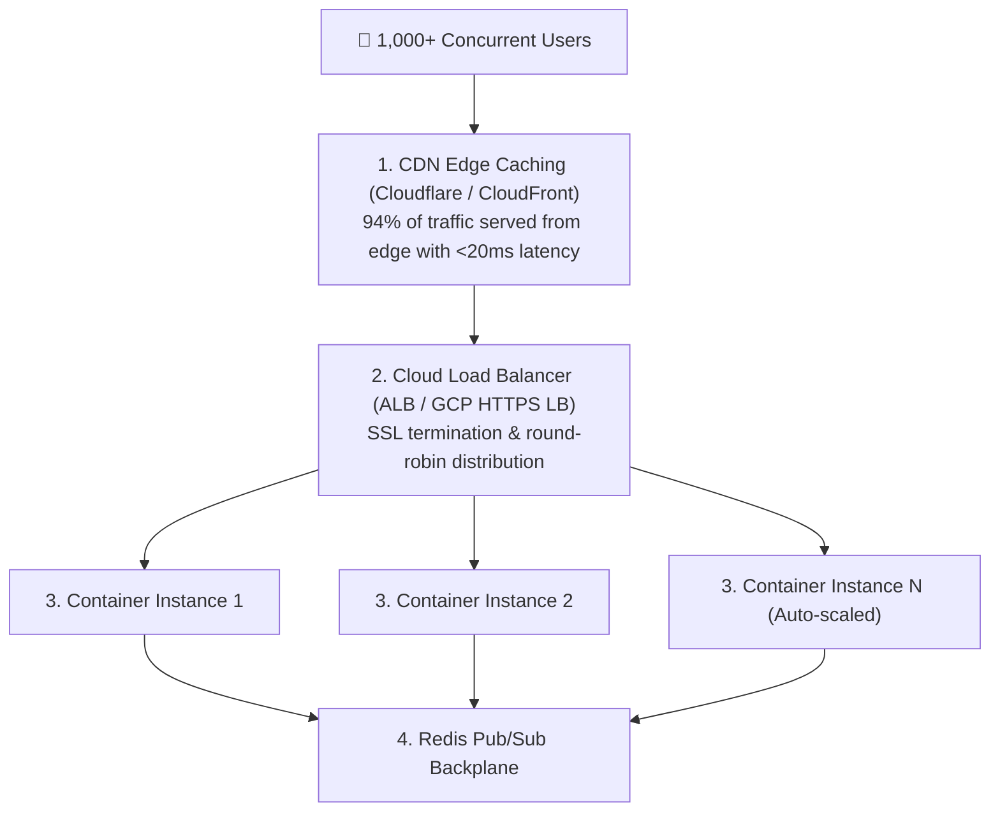

# 🌐 NetLab: Network Architecture & Protocol Visualizer

> An interactive educational web application designed to visually explain **client-server networking, hop-by-hop packet routing, the TCP 3-way handshake, HTTP protocol semantics, edge reverse tunneling, and system scalability** when scaling from 1 to 10,000+ concurrent users.

---

## 🎯 Pedagogical Objectives

When software engineers and students build web applications, network communication often feels like an invisible black box:
- *What happens between the millisecond a user taps a link on their smartphone and the server returning HTML?*
- *How does a packet traverse mobile cellular towers (RAN), carrier NATs, public BGP backbones, and reverse proxies?*
- *Why is a TCP 3-way handshake required before any HTTP or TLS data can be transferred?*
- *Why do residential machines require reverse SSH tunnels to be accessible on the public internet?*
- *What actually breaks when 1,000 users visit a single-node web server simultaneously?*

**NetLab** demystifies every layer of the network stack through live interactive visualizations, packet flow simulations, status code experiments, and a real-time scalability stress-test model.

---

## 🏛️ End-to-End Hop Flow Architecture

Every HTTP request traverses seven critical architectural boundaries:



---

## 🧱 The 4-Layer TCP/IP Model

| Layer | Protocols & Technologies | Data Unit | Role in Web Communication |
|---|---|---|---|
| **4. Application** | HTTP/1.1, HTTP/2, HTTP/3, DNS, TLS 1.3 | Message / Payload | Formats request lines, headers (`User-Agent`, `Host`), cookies, and JSON/HTML bodies. |
| **3. Transport** | TCP, UDP, QUIC | Segment / Datagram | Manages reliable ordered delivery, flow control, port addressing (e.g. 443, 8080), and retransmission. |
| **2. Internet** | IPv4, IPv6, ICMP, BGP | IP Packet | Encapsulates segments into packets with source and destination IP addresses; routed across Autonomous Systems (AS). |
| **1. Link / Physical** | Ethernet (802.3), Wi-Fi (802.11ax), 5G NR | Frame / Bits | Modulates bits into electromagnetic radio waves or laser pulses over optical fiber. |

---

## 🤝 The TCP 3-Way Handshake

Before HTTP data can travel, TCP establishes synchronization through a 3-step handshake:

```text
Client                                Server
  |                                      |
  | -------- SYN (Seq=1000) -----------> |  Step 1: Client sends SYN (State: SYN_SENT)
  |                                      |
  | <-- SYN-ACK (Seq=5000, Ack=1001) --- |  Step 2: Server synchronizes and ACKs (State: SYN_RCVD)
  |                                      |
  | -------- ACK (Seq=1001, Ack=5001) -> |  Step 3: Client acknowledges server SYN (State: ESTABLISHED)
  |                                      |
  | ====== Socket Ready for Data ======  |
```

---

## 📈 Scalability Analysis: What Happens When 1,000+ Users Visit?

When 1,000 users simultaneously visit a single-host reverse tunnel, four catastrophic bottlenecks occur:

1. **Tunnel Edge Socket Cap:** Free tunnel services limit concurrent sockets to ~20–50 connections. The 51st user receives `HTTP 429 Too Many Requests` or `HTTP 502 Bad Gateway`.
2. **TCP Head-of-Line (HoL) Blocking:** All 1,000 user requests are multiplexed over a **single outbound SSH TCP connection**. If a single packet drops over Wi-Fi, the entire TCP window halts until that packet is retransmitted.
3. **Socket Descriptor Exhaustion:** Persistent streaming connections (e.g. Server-Sent Events or WebSockets) hold open 1,000 file descriptors simultaneously, saturating event loops.
4. **Asymmetric Bandwidth:** Residential upload speeds (often 10–20 Mbps) become queued trying to push megabytes of frontend assets out simultaneously.

### The Production Cloud Solution:


---

## 🛠️ Practical Guide: How to Create a Web App & Host It on the Internet

This section explains how to replicate this entire architecture from scratch: creating a lightweight web application on your local machine and instantly exposing it to the public internet so you can view, test, and analyze it from your smartphone or any remote device.

---

### Step 1: Create the Web Application

You can create a fully functional web server in under 20 lines using only standard libraries:

#### Option A: Python Standard Library (Zero `pip` installs)
Create a file named `server.py`:
```python
import http.server
import socketserver
import json

PORT = 8080

class SimpleHandler(http.server.SimpleHTTPRequestHandler):
    def do_GET(self):
        if self.path == "/api/hello":
            self.send_response(200)
            self.send_header("Content-Type", "application/json")
            self.send_header("Access-Control-Allow-Origin", "*")
            self.end_headers()
            response = {"message": "Hello from your local machine!", "client": self.client_address[0]}
            self.wfile.write(json.dumps(response).encode("utf-8"))
            return
        super().do_GET()

with socketserver.TCPServer(("0.0.0.0", PORT), SimpleHandler) as httpd:
    print(f"Server listening on http://localhost:{PORT}")
    httpd.serve_forever()
```

#### Option B: Node.js Standard Library (Zero `npm` installs)
Create a file named `server.js`:
```javascript
const http = require('http');
const PORT = 3000;

const server = http.createServer((req, res) => {
  res.writeHead(200, {
    'Content-Type': 'application/json',
    'Access-Control-Allow-Origin': '*'
  });
  res.end(JSON.stringify({
    message: "Hello from your local machine!",
    clientIp: req.headers['x-forwarded-for'] || req.socket.remoteAddress,
    userAgent: req.headers['user-agent']
  }, null, 2));
});

server.listen(PORT, '0.0.0.0', () => {
  console.log(`Server listening on http://localhost:${PORT}`);
});
```

Run your server in your terminal:
```bash
python server.py   # For Python (port 8080)
# or
node server.js     # For Node.js (port 3000)
```

---

### Step 2: Expose Your Local Server to the Public Internet

Residential computers sit behind home Wi-Fi routers and carrier NAT (Network Address Translation). They have private IP addresses (e.g., `192.168.x.x`) and cannot receive incoming traffic directly from the internet.

To bypass this without opening router firewall ports or purchasing a public IP address, you can use **Reverse SSH Tunneling** or **Edge Tunnels**:

#### Method 1: Instant Public SSH Tunnel (Zero Software to Install)
Open a new terminal and run:
```bash
# For Python server on port 8080:
ssh -T -o StrictHostKeyChecking=no -R 80:127.0.0.1:8080 nokey@localhost.run

# For Node.js server on port 3000:
ssh -T -o StrictHostKeyChecking=no -R 80:127.0.0.1:3000 nokey@localhost.run
```
* **How it works:** OpenSSH initiates an *outbound* persistent connection to the cloud tunnel server. The remote server assigns you a unique public HTTPS URL (e.g., `https://xxxxxx.lhr.life`).
* **Edge TLS Termination:** The cloud tunnel provides an SSL certificate and handles encryption (`HTTPS` on port `443`), forwarding the decrypted data over the SSH pipe into your local port.

#### Method 2: Cloudflare Quick Tunnel (Alternative)
If you have `cloudflared` installed:
```bash
cloudflared tunnel --url http://localhost:8080
```
This gives you a free, temporary `https://<random-id>.trycloudflare.com` URL backed by Cloudflare's global edge network.

---

### Step 3: Access from Your Mobile Browser

1. Copy the generated `https://...` URL or scan its QR code using your phone's camera.
2. Open it in Safari or Chrome over **mobile 4G/5G cellular data** (not just local Wi-Fi).
3. The request travels through your phone's cellular tower $\rightarrow$ ISP gateway $\rightarrow$ cloud tunnel edge $\rightarrow$ SSH pipe $\rightarrow$ your laptop's local socket!

---

### Step 4: Transitioning from Temporary Tunnel to Permanent Cloud Hosting

For permanent 24/7 cloud deployment where your laptop does not need to stay awake:

| Hosting Platform | Deployment Method | Cost | Best For |
|---|---|---|---|
| **Google Cloud Run** | `gcloud run deploy --source .` | Free tier (2M req/month) | Containerized Docker workloads |
| **Render / Railway** | Connect GitHub repo $\rightarrow$ auto-deploy | Free / Hobby tiers | Web services & APIs |
| **Vercel / Netlify** | `vercel deploy` | Free tier | Static frontends & serverless functions |

---

## 🚀 Running Locally

### 1. Zero-Dependency Standalone Python Server
```bash
cd network-protocol-visualizer
python server.py
# Server starts at http://localhost:8080
```

### 2. Docker Container
```bash
docker build -t netlab .
docker run -p 8080:8080 -e PORT=8080 netlab
```

### 3. Automated Verification Tests
```bash
node test_app.js
```

---

## 📄 License

This project is licensed under the [MIT License](../LICENSE).
